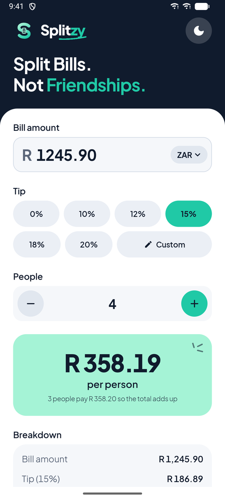
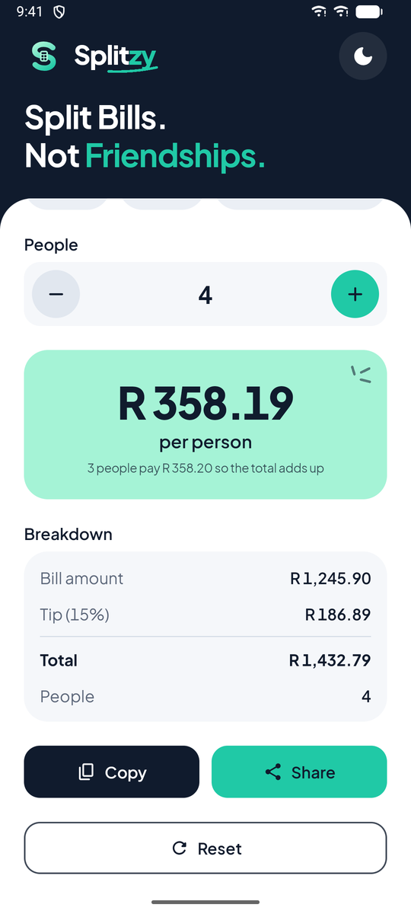
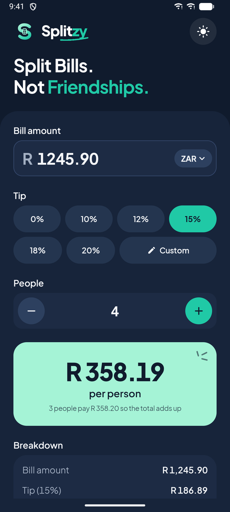
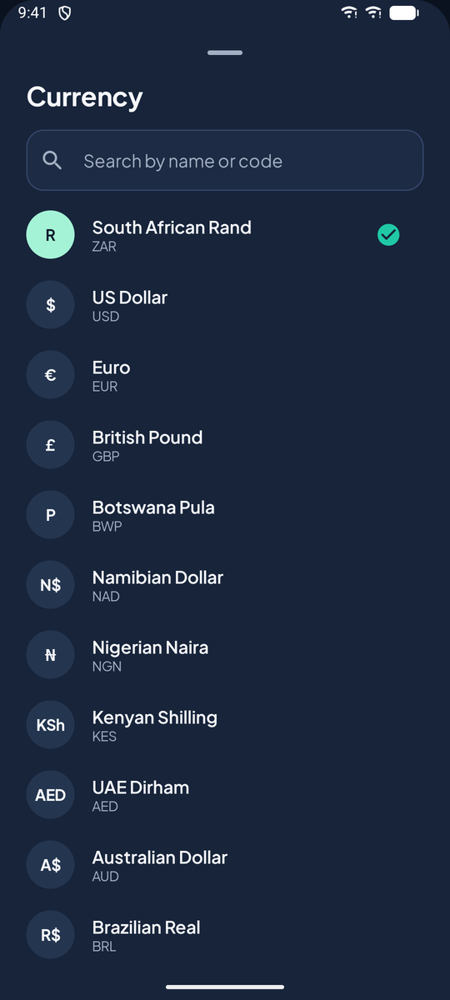

# Splitzy

**Split Bills. Not Friendships.**

An offline Android bill-splitting calculator. You enter the bill, pick a tip and set how many people are paying, and it shows what each person owes.

<!-- Google Play link goes here once the app is published -->

<p align="center">
  
  
  
  
</p>

## What it does

- Tip presets of 0, 10, 12, 15, 18 and 20%, or a custom tip from 0 to 100%
- Splits between 1 and 99 people
- Leftover cents go to a few people so the shares add up exactly (R100 ÷ 3 = R33.33, R33.33, R33.34)
- 18 currencies, using the correct number of decimals for each (JPY has none)
- Copy the amount each person owes, or share the full breakdown
- Light and dark themes
- Two-pane layout on tablets, foldables and phones in landscape
- No account, no ads, no permissions, no network

## Build

You need Android Studio or JDK 17+ with the Android SDK.

```bash
./gradlew installDebug          # build and install on a device or emulator
./gradlew testDebugUnitTest     # unit tests
./gradlew assembleBenchmark     # R8-optimised build, debug-signed
```

## Code

```
app/src/main/java/app/splitzy/
├── domain/      Calculation, input parsing, currencies (pure Kotlin)
├── data/        Saved preferences (DataStore)
├── ui/          Compose screen, ViewModel, theme
└── MainActivity.kt
```

Built with Kotlin, Jetpack Compose and Material 3. Money is handled with `BigDecimal` throughout. minSdk 24, targetSdk 37.
